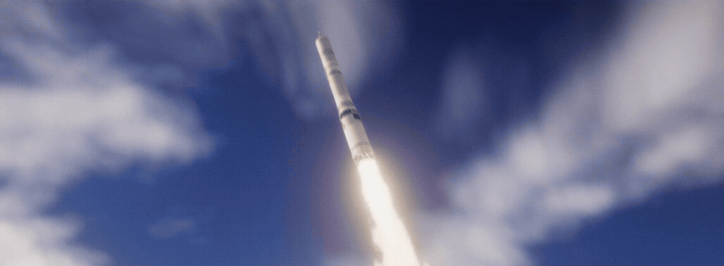
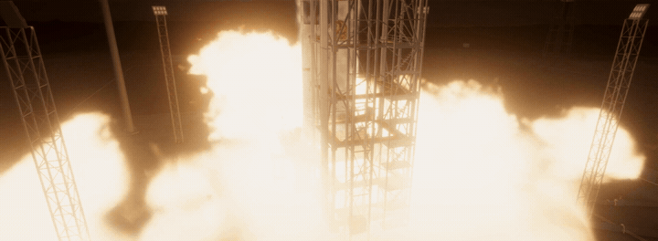
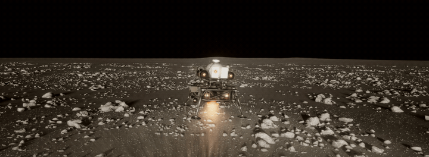
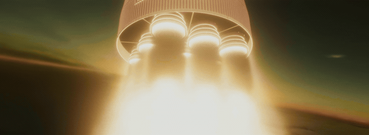
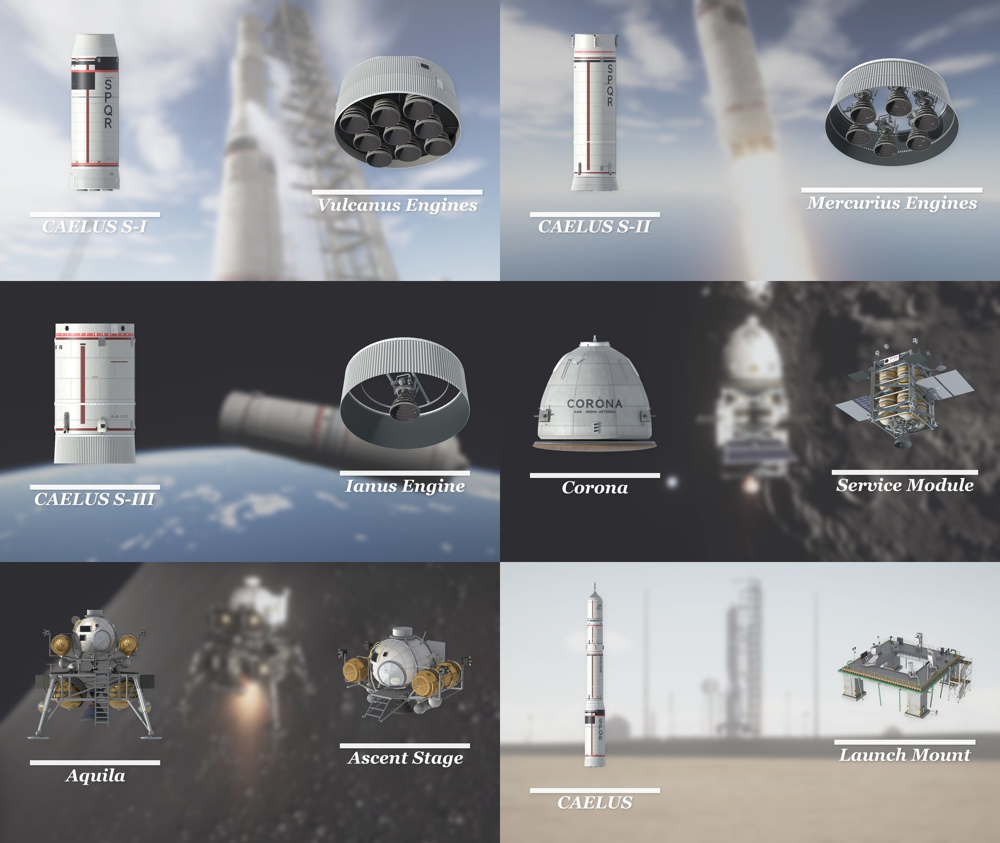

# CAELUS

A three-stage Moon rocket for Kerbal Space Program 1.12, with the Corona command module, the Aquila lunar lander and the Statio Caelestis Aromata launch site. It's built for real-scale solar systems. The setting is an alternate 20th century where a Roman Federation is racing for the Moon with believable 1960s hardware.

**[Download the latest release](../../releases/latest)**: `CAELUS.zip`, `StatioCaelestisAromata_FREE.zip` (launch site) and `CAELUS_RomanSuit.zip`.

 

## What you get (free)
- **CAELUS rocket**: S-I, S-II and S-III stages, a launch escape tower and four fairing petals, in New, Used and Plain finishes.
- **Corona**: a three-seat command module with a service module, a full cabin (IVA), real cloth parachutes and re-entry scorching. After splashdown it floats upright.
- **Aquila**: a two-stage lunar lander with a full cabin (IVA), landing dust and landing marks.
- **Our own effects**: engine flames, exhaust smoke, pad steam, frost and venting vapour on the cold tanks, Mach condensation, RCS plumes, glowing engine bells and lunar landing dust. Every effect has quality settings and an on/off switch.
- **kOS mission (optional)**: a button menu that can fly the whole Moon mission, from launch to splashdown.
- **Statio Caelestis Aromata**: a launch complex at Ras Hafun on Sol's Earth, with two big pads, a 134 m service tower with swing arms, a launch mount you can use with any rocket, the smaller Ordo Missilium pads, night lighting and roads.
- **Roman EVA suit**: an optional 1960s-style pressure suit with a silver visor.

 

## Requirements
- KSP 1.12.3 or newer (Windows, Direct3D 11 for the effects; on Mac/Linux the parts work but our effects switch off).
- ModuleManager, Harmony, TexturesUnlimited, KSPCommunityFixes (1.28+), Kerbal Joint Reinforcement Continued.
- A real-scale solar system: Sol (recommended, install through CKAN) or RSS. It also works at Sol Quarter / Stock scale and on stock Kerbin, with less fuel and hand flying only.
- Launch site: Kerbal Konstructs and Kopernicus with Sol.
- Recommended: kOS, Ferram Aerospace Research, Hangar Extender, and TUFX (CAELUS ships its own TUFX profiles: pick **CAELUS-Cinematic**, or **CAELUS-Cinematic-IVA** for the cabins).
- Using Raymarched Plume Trails? It still works on your other rockets. CAELUS just tells it to skip CAELUS engines, so you don't get two trails.
- If a required mod is missing, a window at the main menu tells you which one and why.

## Install
Copy the `GameData` and `Ships` folders from the zip into your KSP folder. With kOS, choose PermitAllConnectivityManager when kOS asks. Ready-made crafts: `CAELUS.craft` (on the site's launch mount) and `CAELUS_Clamps.craft` (stock clamps, any launch site).

## Source
The plugin source is in [`src/`](src): `src/CAELUS` (effects, entry, parachutes and part plugins) and `src/StatioCaelestisAromata` (launch site plugins). The same source ships inside the downloads.

## Licence
- Art, models, configs and crafts: CC BY-NC-SA 4.0.
- Plugin code and kOS scripts: MIT.
- Details: [LICENCE.txt](LICENCE.txt).

## Support
CAELUS is free. If you enjoy it, you can support Alternate Orbital Studios on Patreon. Supporters get extra content: https://www.patreon.com/c/alternate_orbital_studios

## Bugs
Open an issue here, or post on the forum thread with your `KSP.log`, and we'll sort it out. For quicker help and more frequent updates, join our Discord: https://discord.gg/pJcnUVdJS

Made by Alternate Orbital Studios.
